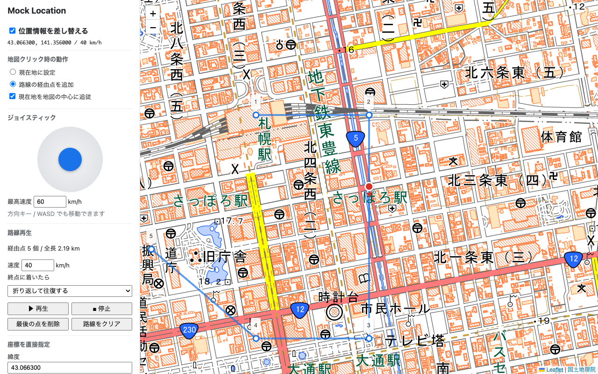

# Mock Location

Chrome 上の Web ページが取得する位置情報（`navigator.geolocation`）を、地図で指定した場所に差し替える開発者向け Chrome 拡張機能です。
Chrome DevTools の「Sensors」と同じく、`Emulation.setGeolocationOverride` で位置情報を上書きします。



## 機能

- **地点指定**：地図をクリック、またはマーカーをドラッグして現在地を設定
- **路線再生**：地図上で経由点を指定し、指定速度で移動（終点で停止 / 始点から繰り返し / 往復）
- **ジョイスティック**：倒した方向・強さに応じて連続移動。方向キー / WASD でも操作可能
- **直接入力**：座標の入力、プリセット地点の選択
- 移動中は進行方向（`heading`）と速度（`speed`）も通知

## インストール

[Chrome ウェブストア](https://chromewebstore.google.com/detail/mock-location/mkbfjbdjkjladjpdpgflcamahfnmkcbm) からインストールしてください。

## インストール（開発版）

1. このリポジトリを clone する
2. Chrome で `chrome://extensions` を開き、右上の「デベロッパー モード」をオンにする
3. 「パッケージ化されていない拡張機能を読み込む」でリポジトリのフォルダを選択する
4. ツールバーのアイコンをクリックすると、操作画面が開く

## 注意事項

- 有効中はブラウザ上部に「デバッグを開始しました」と表示されます。「キャンセル」を押すと差し替えが無効になります
- 位置を切り替えるたびに、Chrome の仕様で一瞬 `POSITION_UNAVAILABLE`（code 2）エラーが通知されます
- 路線再生・ジョイスティック操作中は操作画面のウィンドウを閉じないでください

## 配布用 zip の作成

```bash
./scripts/package.sh
```

`dist/` に以下が作成されます。

| ファイル | 用途 |
|---|---|
| `mock-location-store-upload.zip` | Chrome ウェブストアへのアップロード用 |
| `mock-location-extension.zip` | 解凍して読み込む配布用 |

ストアの掲載情報・画像は [`store/`](store/) にあります。

## ライセンス

[MIT](LICENSE)

- 地図ライブラリ [Leaflet](https://leafletjs.com/)（BSD 2-Clause、[`vendor/LEAFLET-LICENSE`](vendor/LEAFLET-LICENSE)）
- 地図タイル [国土地理院 地理院タイル](https://maps.gsi.go.jp/development/ichiran.html)
